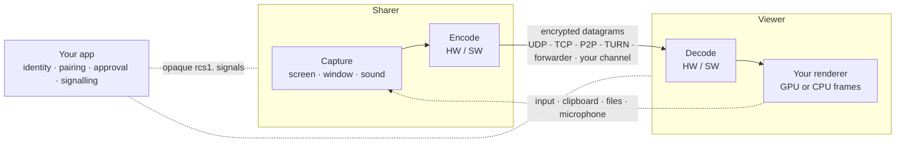

<div align="center">

# Remote Control SDK

**A cross-platform SDK for remote desktop and screen sharing: low latency, end-to-end encrypted, and yours to build on.**

[](LICENSE)
[](CHANGELOG.md)
[](https://github.com/ruoyu-lab/remote-control-sdk/actions/workflows/ci.yml)


**English** · [简体中文](README.zh-CN.md)

</div>

---

Remote Control SDK is the data plane of a remote desktop: screen and sound capture, video and audio codecs, encrypted transport (LAN, P2P through NAT, TURN relay, a group forwarder, or your own channel), adaptive bitrate and remote input. Build a standalone remote desktop or remote support app on it, or embed watching and controlling a screen into anything else — collaboration, education, customer support, messaging, device management, cloud desktops.

It is a library for developers, not an end-user app. It has no UI, no accounts and no server you must run: identity, pairing, approval and signalling stay with your application, which decides everything a user sees.

## Highlights

<table>
<tr>
<td width="50%" valign="top">

**🖥️ Picture**
- H.264, HEVC, VP8, VP9 and AV1, negotiated between the ends
- Hardware encoders and decoders (NVENC, NVDEC, oneVPL, Media Foundation, VideoToolbox, MediaCodec), with built-in software codecs where there are none
- Up to 4K at 120+ FPS; HEVC and AV1 up to 8K; 4:4:4 and 10-bit
- A display, a region, a window or an application; up to four displays at once

</td>
<td width="50%" valign="top">

**🔒 Connection**
- UDP, TCP, P2P with ICE, TURN (UDP, TCP, TLS), a forwarder for groups, or the host's own channel (WebSocket, WebRTC data channel, QUIC…)
- End-to-end encryption with forward secrecy; connection keys, passwords, short PINs (PAKE) and device keys
- Adaptive bitrate, FEC, reference invalidation, automatic reconnection
- Survives network changes (Wi-Fi ↔ cellular, a cable plugged in) without dropping the session

</td>
</tr>
<tr>
<td valign="top">

**🖱️ Control**
- Keyboard, mouse, smooth scrolling, text and IME input, media keys, touch and pen
- Grant, pause or revoke control per viewer; veto input one event at a time, or execute it yourself
- Unattended access: Windows service with the sign-in screen, lock screen and UAC; macOS LaunchDaemon + LaunchAgent

</td>
<td valign="top">

**🔊 Sound and more**
- Both directions: the sharer's sound to viewers, a viewer's microphone back, with echo cancellation
- One stream to up to 256 viewers, lower encodings for weak viewers, admission before anyone watches
- Modules: clipboard (files too), file transfer with resume, power (keep awake, Wake-on-LAN, remote restart), thumbnails, text caret — and your own modules on the same interface

</td>
</tr>
</table>

**Works out of the box, tunable all the way down.** Fill in a role, an address and a key and it runs (H.264 in hardware, 1080p60, 20 Mbit/s). Four presets cover the common trade-offs. Every behavior can be changed through extensions, many while running, and any stage — the codec, the rate decisions, the transport, the capture agent — can be replaced by your own. The SDK never swaps a capability silently: what it cannot do fails with an explicit result and reason.

## Platforms

|  | Share | View | Be controlled | Control | Sound |
| --- | :---: | :---: | :---: | :---: | :---: |
| **macOS** | ✅ | ✅ | ✅ | ✅ | ✅ |
| **Windows** | ✅ | ✅ | ✅ | ✅ | ✅ |
| **iOS / iPadOS** | ✅ app or whole screen ¹ | ✅ | — ² | ✅ | ✅ |
| **Android** | ✅ | ✅ | ✅ ³ | ✅ | ✅ |
| **Browser** (WebAssembly) | — | ✅ | — | ✅ | ✅ |
| **Linux** | the group forwarder server only (`server/forwarder/`) |||||

¹ The app's own picture, or the whole screen through a broadcast extension. ² iOS lets no app control another. ³ Through the host app's accessibility service.

One API on every system: where a system cannot do something, `rcs_capabilities` says so and the call fails with `RCS_ERROR_UNSUPPORTED` and the reason.

## Performance

Glass to glass on a wired LAN — a Windows PC with an RTX 4090 sharing a 3840×2160 159 Hz display, a MacBook Pro (M4 Pro) viewing in the QML demo, HEVC — median latency from a key press to the changed picture on the Mac's screen:

| | 1080p60 | 1080p120 | 4K60 | 4K120 |
| --- | ---: | ---: | ---: | ---: |
| **Remote Control SDK** | **26.1 ms** | **26.8 ms** | **30.9 ms** | **29.0 ms** |
| Moonlight / Sunshine | 27.5 ms | 29.6 ms | 32.3 ms | 34.4 ms |

Methods, Wi-Fi and Android numbers, forwarder capacity and more: [docs/PERFORMANCE.md](docs/PERFORMANCE.md).

## Architecture



The SDK owns the data plane (capture, codecs, transport, encryption, rate control, input, sound); your application owns the control plane (who connects, how they find each other, who may watch or control). See [docs/ARCHITECTURE.md](docs/ARCHITECTURE.md).

## Quick start

Build and run the tests (CMake 3.25+, a C++20 compiler; per-platform presets in [docs/BUILDING.md](docs/BUILDING.md)):

```bash
cmake --preset release
cmake --build --preset release
ctest --preset release
```

Try it with the command-line example — one machine shares, the other views:

```bash
./build/release/bin/rcsdk_cli --generate-key key.bin
./build/release/bin/rcsdk_cli --role share --address <this machine's IP> --key-file key.bin
./build/release/bin/rcsdk_cli --role view  --address <the sharer's IP>   --key-file key.bin
```

Embed it in your own app:

```cpp
#include <rcsdk/rcsdk.hpp>

auto config = rcsdk::SessionConfig(RCS_ROLE_VIEW)          // H.264 in hardware by default
                  .setAddress("192.168.1.20", 47990)
                  .setKey(key)
                  .setCodecs({RCS_CODEC_HEVC, RCS_CODEC_H264}); // HEVC where both ends have it

rcsdk::Callbacks callbacks;
callbacks.onGpuFrame = [&](const rcsdk::GpuFrame& frame) { renderer.draw(frame); };
callbacks.onEvent = [&](const rcs_event& event) { /* state, codec, control, network… */ };

rcsdk::Session session(config, std::move(callbacks));
if (session.start() != RCS_OK) {
    report(session.failure().result, session.failure().message); // e.g. no hardware decoder here
}
```

The public interface is C (`include/rcsdk/rcsdk.h`), so any language can bind to it; `rcsdk.hpp` is a header-only C++ wrapper. Complete C and C++ programs and the steps for each platform are in the developer guide.

## Documentation

> The developer guide is written in Chinese; the headers in `include/rcsdk/` document every function and field in English.

| | |
| --- | --- |
| 📘 [Developer guide](docs/guide/README.md) | Concepts, threading, quick starts per platform, sharing and viewing, transports and signalling, security, input, sound, tuning, events, modules, unattended access, troubleshooting |
| 🏗️ [Architecture](docs/ARCHITECTURE.md) | Layers, data flow, recovery, security, extension points |
| 📐 [API design](docs/API-DESIGN.md) | Principles, version rules, how new capabilities are added |
| ⚡ [Performance](docs/PERFORMANCE.md) | Measurements with devices, settings and end points |
| 🗺️ [Roadmap](docs/ROADMAP.md) | What is implemented, what is verified on real devices, what is next |
| 🧩 [Modules](docs/MODULES.md) | Writing a module |
| 🛠️ [Building](docs/BUILDING.md) | Presets for every platform, the iOS XCFramework, the Android AAR |
| 🔐 [Security assessment](docs/SECURITY-ASSESSMENT.md) | Findings, fixes and residual risks |
| 📝 [Changelog](CHANGELOG.md) | Breaking changes and how to migrate |

## Project status

**0.1.6-beta.** The SDK is feature-rich and tested continuously on macOS, Windows, iOS (simulator) and Android, but it is young: every release before 1.0 may change the API and the wire protocol, and both ends must run the same version. The [roadmap](docs/ROADMAP.md) keeps "verified on real devices" apart from "implemented" — check it before you rely on a feature.

## Repository layout

```text
include/rcsdk/   Public headers: rcsdk.h (C) and rcsdk.hpp (C++), tuning, replaceable stages, modules, platform extras
src/             Implementation: API, session, agent, protocol, transport, crypto, audio, media, platform layers
modules/         Official modules: clipboard, file transfer, power, thumbnail, text caret
components/      Official components beyond a session: the Windows supervisor
server/          The group forwarder (a server; Linux first)
web/             The browser viewer package (WebAssembly)
examples/        Test and demo programs (CLI, host relay, QML demo, unattended service, native viewer)
tools/           Measurement and maintenance programs
tests/           Unit, end-to-end loopback and installed-package tests
third_party/     Vendored libraries and vendor headers, with their licenses
docs/            Documentation
```

## License

[MIT](LICENSE) — free to use, modify and redistribute, including in commercial closed-source products, as long as the copyright and license notices are kept. Third-party code built into the library carries its own permissive licenses: see [THIRD_PARTY_NOTICES.md](THIRD_PARTY_NOTICES.md).
