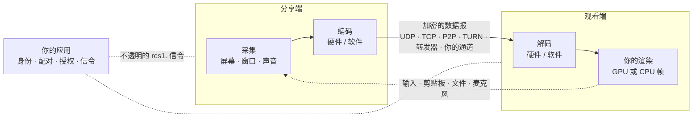

<div align="center">

# 远程控制 SDK

**跨平台的远程桌面与屏幕共享 SDK：低延迟、端到端加密，在它之上做你自己的产品。**

[](LICENSE)
[](CHANGELOG.md)
[](https://github.com/ruoyu-lab/remote-control-sdk/actions/workflows/ci.yml)


[English](README.md) · **简体中文**

</div>

---

远程控制 SDK 提供远程桌面的完整数据面：屏幕和声音采集、音视频编解码、加密传输（局域网、P2P 穿越 NAT、TURN 中继、多人用的转发器，或宿主自己的通道）、动态码率和远程输入。可以在它之上做独立的远程桌面、远程协助软件，也可以把看屏、控屏嵌进任何应用：协作、教育、客服、即时通讯、设备管理、云桌面。

它是给开发者用的库，不是面向最终用户的软件。它没有界面、没有账号，也不要求你部署它的服务器：身份、配对、授权和信令都留在你的应用里，用户看到的一切由你决定。

## 亮点

<table>
<tr>
<td width="50%" valign="top">

**🖥️ 画面**
- H.264、HEVC、VP8、VP9、AV1，两端协商
- 硬件编解码（NVENC、NVDEC、oneVPL、Media Foundation、VideoToolbox、MediaCodec），没有硬件编解码器的系统用自带的软件编解码器
- 最高 4K 120 帧以上；HEVC、AV1 到 8K；4:4:4、10 位
- 共享显示器、一块区域、一个窗口或一个应用；最多同时 4 块显示器

</td>
<td width="50%" valign="top">

**🔒 连接**
- UDP、TCP、P2P（ICE）、TURN（UDP、TCP、TLS）、多人用的转发器，或宿主自己的通道（WebSocket、WebRTC 数据通道、QUIC……）
- 端到端加密、前向保密；连接密钥、口令、短 PIN（PAKE）、设备密钥
- 动态码率、丢包修复（FEC）、参考帧失效、断线自动重连
- 网络变化（Wi-Fi 和蜂窝之间切换、插上网线）时会话不断

</td>
</tr>
<tr>
<td valign="top">

**🖱️ 控制**
- 键盘、鼠标、平滑滚动、文字和输入法、媒体键、触摸和笔
- 按观看端授权、暂停、收回控制权；逐条否决输入，或全部交给你自己执行
- 无人值守：Windows 服务，登录屏、锁屏、UAC 下也能用；macOS 的 LaunchDaemon + LaunchAgent

</td>
<td valign="top">

**🔊 声音和更多**
- 两个方向：分享端的声音到观看端，观看端的麦克风回传，带回声消除
- 一份编码发给最多 256 个观看端，给弱网的观看端低一档，先准入再观看
- 模块：剪贴板（含文件）、可断点续传的文件传输、电源（保持唤醒、网络唤醒、远程重启）、缩略图、文本插入点；你自己的模块用同一套接口

</td>
</tr>
</table>

**开箱即用，也能一路定制到底。** 只填角色、地址和密钥就能跑通（默认 H.264 硬件编解码、1080p60、20 Mbit/s），四个预设覆盖常见的取舍。每一项行为都能经扩展调整，很多能在运行中改；内部的任何一环（编解码器、码率决定、传输、采集助手）都可以换成你自己的。SDK 从不悄悄替换能力：做不到就返回明确的结果和原因。

## 平台

|  | 分享 | 观看 | 被控 | 控制别人 | 声音 |
| --- | :---: | :---: | :---: | :---: | :---: |
| **macOS** | ✅ | ✅ | ✅ | ✅ | ✅ |
| **Windows** | ✅ | ✅ | ✅ | ✅ | ✅ |
| **iOS / iPadOS** | ✅ 应用或整个屏幕 ¹ | ✅ | — ² | ✅ | ✅ |
| **Android** | ✅ | ✅ | ✅ ³ | ✅ | ✅ |
| **浏览器**（WebAssembly） | — | ✅ | — | ✅ | ✅ |
| **Linux** | 只有多人用的转发器服务器（`server/forwarder/`） |||||

¹ 应用自己的画面，或经广播扩展共享整个屏幕。² iOS 不允许任何应用控制别的应用。³ 经宿主应用的无障碍服务。

每个系统上都是同一套接口：系统做不到的，`rcs_capabilities` 会说明，调用以 `RCS_ERROR_UNSUPPORTED` 和原因失败。

## 性能

有线局域网，屏幕到屏幕：Windows PC（RTX 4090）共享 3840×2160 159 Hz 的显示器，MacBook Pro（M4 Pro）在 QML 示例里观看，HEVC。从按键到 Mac 屏幕上画面变化的中位延迟：

| | 1080p60 | 1080p120 | 4K60 | 4K120 |
| --- | ---: | ---: | ---: | ---: |
| **远程控制 SDK** | **26.1 ms** | **26.8 ms** | **30.9 ms** | **29.0 ms** |
| Moonlight / Sunshine | 27.5 ms | 29.6 ms | 32.3 ms | 34.4 ms |

测量方法、Wi-Fi 和 Android 上的数字、转发器的容量等见 [docs/PERFORMANCE.md](docs/PERFORMANCE.md)。

## 架构



SDK 负责数据面（采集、编解码、传输、加密、码率、输入、声音）；你的应用负责控制面（谁来连、怎么找到对方、谁能看、谁能控）。详见 [docs/ARCHITECTURE.md](docs/ARCHITECTURE.md)。

## 快速开始

编译并运行测试（CMake 3.25+、C++20 编译器；各平台的预设见 [docs/BUILDING.md](docs/BUILDING.md)）：

```bash
cmake --preset release
cmake --build --preset release
ctest --preset release
```

用命令行示例试一下，一台分享、一台观看：

```bash
./build/release/bin/rcsdk_cli --generate-key key.bin
./build/release/bin/rcsdk_cli --role share --address <本机 IP>   --key-file key.bin
./build/release/bin/rcsdk_cli --role view  --address <分享端 IP> --key-file key.bin
```

接进你自己的应用：

```cpp
#include <rcsdk/rcsdk.hpp>

auto config = rcsdk::SessionConfig(RCS_ROLE_VIEW)          // 默认 H.264 硬件编解码
                  .setAddress("192.168.1.20", 47990)
                  .setKey(key)
                  .setCodecs({RCS_CODEC_HEVC, RCS_CODEC_H264}); // 两端都有 HEVC 时用 HEVC

rcsdk::Callbacks callbacks;
callbacks.onGpuFrame = [&](const rcsdk::GpuFrame& frame) { renderer.draw(frame); };
callbacks.onEvent = [&](const rcs_event& event) { /* 状态、编解码器、控制权、网络…… */ };

rcsdk::Session session(config, std::move(callbacks));
if (session.start() != RCS_OK) {
    report(session.failure().result, session.failure().message); // 例如本机没有硬件解码器
}
```

公开接口是 C（`include/rcsdk/rcsdk.h`），任何语言都能绑定；`rcsdk.hpp` 是纯头文件的 C++ 包装。完整的 C、C++ 程序和各平台的步骤见开发者指南。

## 文档

| | |
| --- | --- |
| 📘 [开发者指南](docs/guide/README.md) | 概念、线程、各平台的快速开始、分享和观看、传输和信令、安全、输入、声音、调优、事件、模块、无人值守、故障排查 |
| 🏗️ [架构](docs/ARCHITECTURE.md) | 分层、数据流、恢复机制、安全、扩展点 |
| 📐 [接口设计](docs/API-DESIGN.md) | 设计原则、版本规则、新能力怎样加入 |
| ⚡ [性能](docs/PERFORMANCE.md) | 写明设备、设置和测量终点的实测 |
| 🗺️ [路线图](docs/ROADMAP.md) | 实现了什么、哪些在真机上验证过、接下来做什么 |
| 🧩 [模块](docs/MODULES.md) | 怎样写一个模块 |
| 🛠️ [构建](docs/BUILDING.md) | 各平台的预设、iOS 的 XCFramework、Android 的 AAR |
| 🔐 [安全评估](docs/SECURITY-ASSESSMENT.md) | 发现的问题、修复和残余风险 |
| 📝 [更新记录](CHANGELOG.md) | 破坏性修改和迁移方法 |

## 项目状态

**0.1.4-beta。** 功能已经很全，持续在 macOS、Windows、iOS（模拟器）和 Android 上测试，但它还年轻：1.0 之前每个版本都可能改接口和网络协议，两端必须运行同一个版本。[路线图](docs/ROADMAP.md)把"真机上验证过"和"已实现"分开写，依赖某项功能之前请先看一眼。

## 目录

```text
include/rcsdk/   公开头文件：rcsdk.h（C）和 rcsdk.hpp（C++）、调优、可替换的环节、模块、平台专用
src/             实现：接口、会话、助手、协议、传输、密码学、声音、媒体、各平台层
modules/         官方模块：剪贴板、文件传输、电源、缩略图、文本插入点
components/      会话之外的官方组件：Windows 的看护者
server/          多人用的转发器（服务器，首要平台是 Linux）
web/             浏览器观看端包（WebAssembly）
examples/        测试和演示程序（命令行、宿主中继、QML 示例、无人值守服务、原生观看端）
tools/           测量和维护用的程序
tests/           单元测试、端到端回环测试、安装包测试
third_party/     随 SDK 编译的库和厂商头文件，附各自的许可
docs/            文档
```

## 许可

[MIT](LICENSE)：可以自由使用、修改和再分发，包括商业闭源产品，保留版权和许可声明即可。编进库里的第三方代码各有宽松的许可，见 [THIRD_PARTY_NOTICES.md](THIRD_PARTY_NOTICES.md)。
